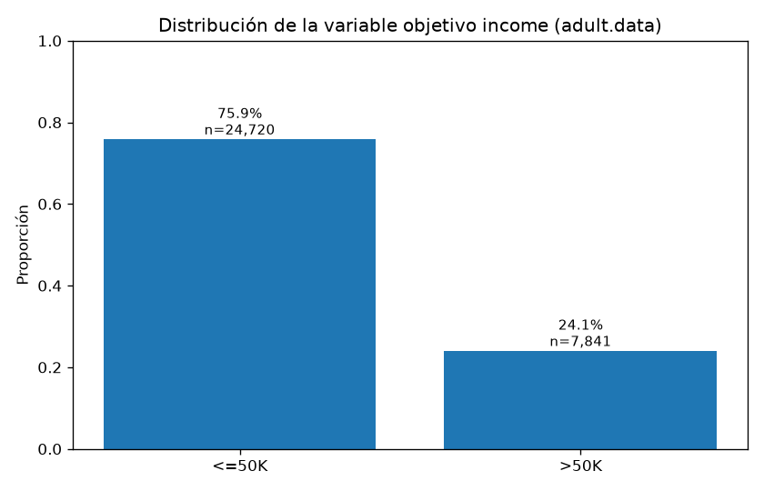
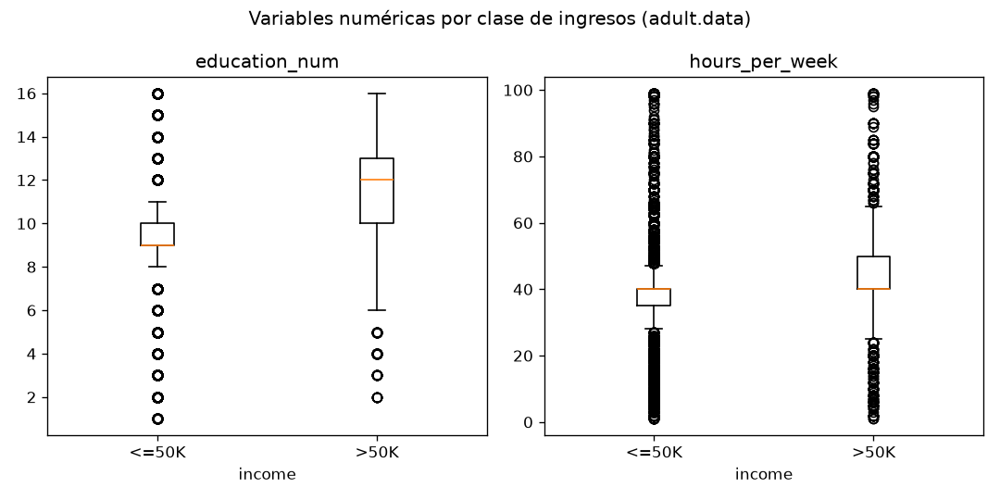
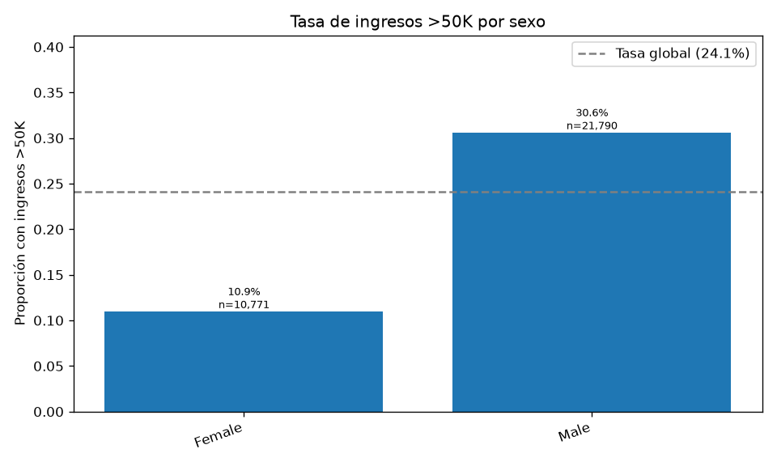
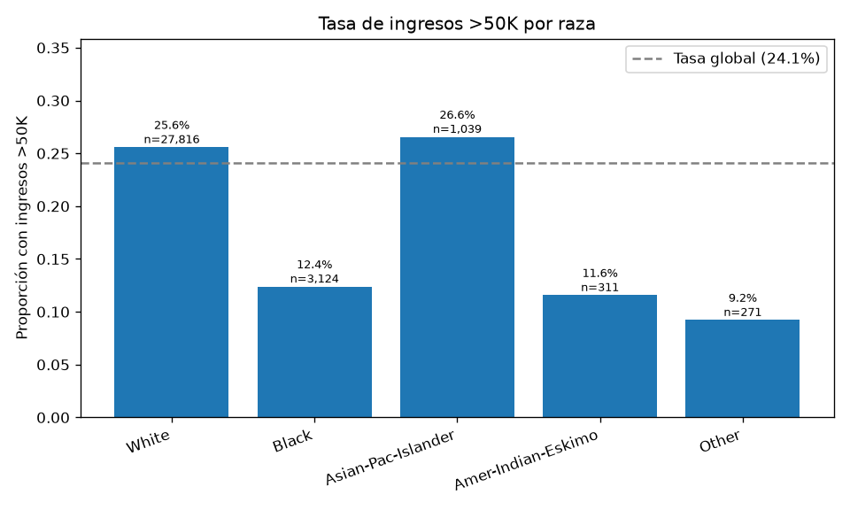
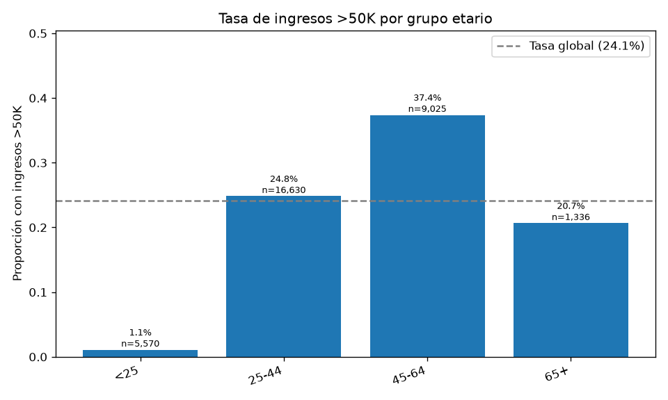
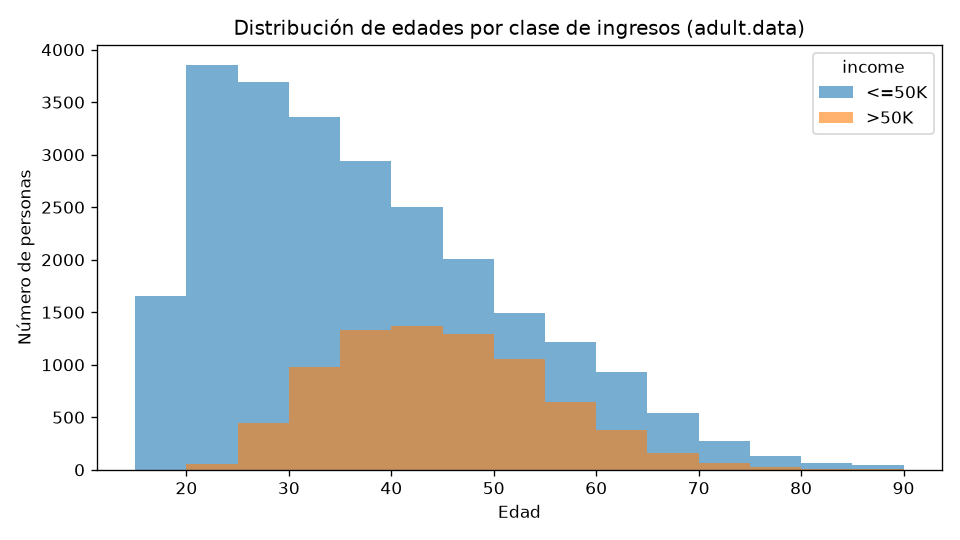

# Resumen del análisis exploratorio (EDA) — UCI Adult

Issue relacionado: #3
Autora: Emma Cabrera
Reproducción: `python src/download_data.py` y luego `python src/eda.py`

## 1. Alcance y decisiones

- Todas las estadísticas se calculan exclusivamente sobre `adult.data` (32,561 registros). `adult.test` queda reservado para la evaluación final de los modelos y no se utiliza en el EDA.
- Los registros con valores faltantes en una variable de agrupación se reportan en la categoría `(faltante)` en lugar de excluirse. En `adult.data`, `sex`, `race` y `age` no tienen faltantes, por lo que las tablas por grupo no cambian.
- La carga utiliza `load_data()` de `src/inspect_data.py`, el procedimiento común del proyecto.
- No se repite la auditoría de calidad (faltantes, duplicados y coincidencias), documentada en `docs/DATASET_CARD.md`.
- Los grupos etarios (`<25`, `25-44`, `45-64`, `65+`) son provisionales y deben confirmarse en el acuerdo metodológico del equipo.

Salidas generadas:
- Tablas: `reports/eda/` (`distribucion_income.csv`, `resumen_numericas.csv`, `distribucion_categoricas.csv`, `tasa_ingresos_por_grupo.csv`).
- Gráficos: `reports/figures/eda_*.png`.

## 2. Variable objetivo

| Clase | n | Proporción |
|---|---:|---:|
| `<=50K` | 24,720 | 75.92 % |
| `>50K` | 7,841 | 24.08 % |

Interpretación: las clases están desbalanceadas. Un clasificador que siempre prediga `<=50K` tendría un accuracy de aproximadamente 75.9 % sin aprender nada. Por eso la comparación de modelos debe basarse en F1, precisión y recall, y no en el accuracy. El desbalance también justifica la partición estratificada acordada.

## 3. Variables numéricas

| Variable | Media | Mediana | Mín. | Máx. | Proporción de ceros |
|---|---:|---:|---:|---:|---:|
| age | 38.58 | 37 | 17 | 90 | 0.00 |
| education_num | 10.08 | 10 | 1 | 16 | 0.00 |
| hours_per_week | 40.44 | 40 | 1 | 99 | 0.00 |
| capital_gain | 1,077.65 | 0 | 0 | 99,999 | 0.92 |
| capital_loss | 87.30 | 0 | 0 | 4,356 | 0.95 |
| fnlwgt | 189,778.37 | 178,356 | 12,285 | 1,484,705 | 0.00 |

Interpretación:
- `capital_gain` y `capital_loss` son muy asimétricas: el 92 % y el 95 % de los registros valen 0. El máximo de `capital_gain` (99,999) parece un valor tope del censo.
- `fnlwgt` es un peso muestral del censo, no una característica de la persona; su uso como predictor se decidirá en el acuerdo metodológico.
- `hours_per_week` se concentra en 40 horas (mediana y primer cuartil).

## 4. Tasa de ingresos `>50K` por grupo

### Sexo

| Grupo | n | % de la muestra | Tasa `>50K` |
|---|---:|---:|---:|
| Female | 10,771 | 33.08 % | 10.95 % |
| Male | 21,790 | 66.92 % | 30.57 % |

La tasa de los hombres es unas 2.8 veces la de las mujeres (diferencia de 19.6 puntos porcentuales), y los hombres representan dos tercios de la muestra.

### Raza

| Grupo | n | % de la muestra | Tasa `>50K` |
|---|---:|---:|---:|
| White | 27,816 | 85.43 % | 25.59 % |
| Black | 3,124 | 9.59 % | 12.39 % |
| Asian-Pac-Islander | 1,039 | 3.19 % | 26.56 % |
| Amer-Indian-Eskimo | 311 | 0.96 % | 11.58 % |
| Other | 271 | 0.83 % | 9.23 % |

### Grupo etario

| Grupo | n | % de la muestra | Tasa `>50K` |
|---|---:|---:|---:|
| <25 | 5,570 | 17.11 % | 1.10 % |
| 25-44 | 16,630 | 51.07 % | 24.83 % |
| 45-64 | 9,025 | 27.72 % | 37.39 % |
| 65+ | 1,336 | 4.10 % | 20.66 % |

## 5. Limitaciones de representación

- **Raza:** `White` concentra el 85.4 % de los registros. `Amer-Indian-Eskimo` (311) y `Other` (271) representan menos del 1 % cada uno, por lo que las métricas por grupo serán inestables y deben reportarse con su tamaño muestral o agruparse según lo que acuerde el equipo.
- **Sexo:** las mujeres son un tercio de la muestra y tienen una tasa base mucho menor de ingresos `>50K`.
- **Edad:** el grupo `65+` es pequeño (4.1 %) y el grupo `<25` casi no tiene casos positivos (61), lo que limita la evaluación de errores en esos grupos.
- **Antigüedad:** los datos provienen del censo de EE. UU. de 1994 y no representan poblaciones actuales.

## 6. Implicaciones para el modelado y la auditoría

1. Las diferencias observadas son **tasas base de los datos**, no sesgo de un modelo. Muestran desigualdades presentes en los datos que un modelo entrenado con ellos puede reproducir; la auditoría de TPR/FPR por grupo medirá si eso ocurre.
2. Una disparidad estadística no constituye por sí sola evidencia de discriminación (ver `docs/DATASET_CARD.md`).
3. El desbalance de clases justifica usar F1, precisión, recall y calibración en lugar del accuracy, y una partición estratificada.
4. Variables como `relationship` (`Husband` / `Wife`) y `marital_status` pueden actuar como indicadores indirectos del sexo; excluir `sex` de los predictores no elimina esa información.
5. Los grupos pequeños requieren reportar el tamaño muestral junto a cada métrica.
